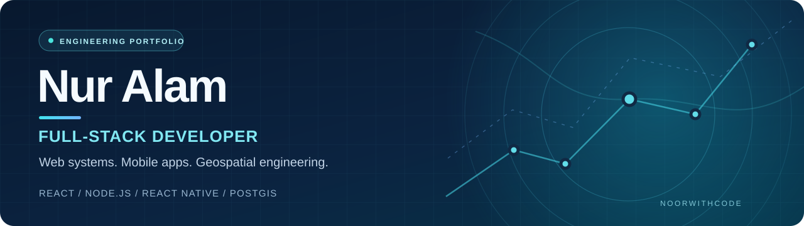

  

  <strong>Turning real-world problems into reliable software.</strong> 
  Full-stack engineering · Mobile development · Maps & routing

  
  
  

## About me

I'm **Nur Alam**, a full-stack developer with an **M.Sc. in Computer & Information Science**. I design and build end-to-end products across web, mobile, backend infrastructure, and location-based services.

I care about practical engineering challenges: **data consistency, secure application workflows, offline-first experiences, geospatial algorithms, and dependable production systems**. My work ranges from pharmacy operations software to cycling navigation and live-location sharing.

- **Primary focus:** Full-stack JavaScript/TypeScript, React, Node.js, React Native
- **Engineering interests:** Geospatial systems, offline routing, system reliability, API architecture
- **Currently exploring:** Safety-aware cycling navigation and road-context research
- **Based in:** West Bengal, India

## Selected projects

### 01 — CycleNav+ | Offline-first cycling navigation

A bicycle navigation system focused on practical urban routing. Built with **React Native, NestJS, PostgreSQL/PostGIS, Redis, and MapLibre**.

- Offline maps and A* routing prototypes for the Frankfurt–Hanau area
- Route guidance, off-route detection, rerouting, and saved routes
- Consent-based live-location sharing with WebSocket updates
- Experimental research into cycling access, road conditions, and safer navigation decisions

**Focus:** Mobile architecture · Geospatial routing · Real-time systems  
**Explore:** [Download Android APK](https://github.com/Noorwithcode/cyclenav-demo/releases/download/v1.0.0/CycleNav-Plus-v1.0.0-arm64.apk) · [GitHub source](https://github.com/Noorwithcode/cyclenav-demo)

### 02 — PharmaERP | Pharmacy operations & inventory

A full-stack pharmacy management application built around transaction integrity, batch-level inventory control, and operational workflows.

- POS billing, purchasing, sales returns, and supplier/customer management
- Batch-level stock movement, FEFO handling, and GST-ready invoices
- Role-based authentication, reporting, and payment status tracking
- Concurrency-safe inventory updates and audit-oriented operations

**Stack:** React · Node.js · Express · MySQL  
**Explore:** [Live application](https://pharma-erp-opal.vercel.app/) · [Source code](https://github.com/Noorwithcode/PharmaERP)

### 03 — Enterprise IT Helpdesk | Support operations

A service-desk application for handling tickets through an accountable support workflow.

- Role-based ticket management and assignment
- SLA tracking, attachments, ticket lifecycle and reporting
- Dashboard views for open, resolved, closed, and breached tickets

**Stack:** React · Node.js · Express · MySQL  
**Focus:** IT operations · Workflow design · API development

### 04 — PulseOps | Service and server monitoring

A backend monitoring project built around service registration, heartbeat tracking, and status visibility.

- Service registry and heartbeat-based availability updates
- Administrative access and health checks
- Practical monitoring workflows for online/offline transitions

**Stack:** Node.js · Express · MySQL  
**Focus:** Backend engineering · Observability fundamentals

## Technical toolkit

| Area | Technologies |
| --- | --- |
| **Frontend** | React, TypeScript, JavaScript, HTML, CSS |
| **Mobile** | React Native, Expo, Android |
| **Backend** | Node.js, Express, NestJS, REST APIs, WebSockets |
| **Databases** | PostgreSQL, PostGIS, MySQL, Redis |
| **Mapping & navigation** | OpenStreetMap, MapLibre, offline routing, A* |
| **Workflow & deployment** | Git, GitHub, Vercel, Render, Supabase |

## Engineering principles

> **Make it work. Make it correct. Make it useful.**

- **Reliability:** Model failure paths and protect critical state changes.
- **User experience:** Keep complex technology approachable.
- **Systems thinking:** Design the API, data layer, and client as one product.
- **Continuous learning:** Validate assumptions with prototypes, tests, and measurable results.

## Let's connect

I'm interested in opportunities and collaborations involving **full-stack development, application support, mobile apps, and geospatial software**.

**[View my portfolio](https://animated-portfolio-ten-rho.vercel.app/)** · **[Explore repositories](https://github.com/Noorwithcode?tab=repositories)**

---

  Built with purpose · Nur Alam · @Noorwithcode

